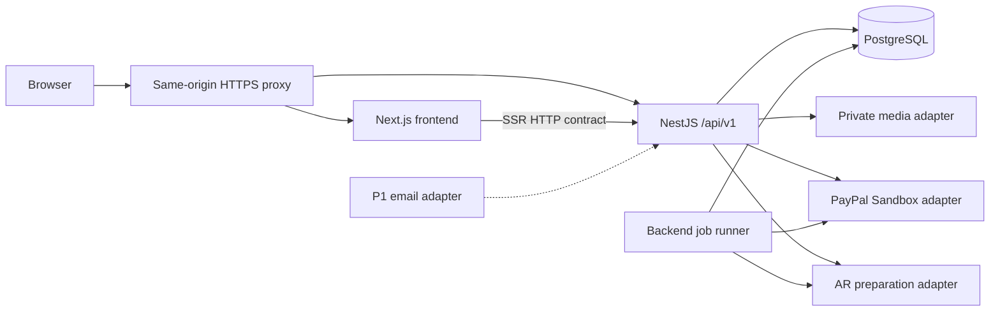
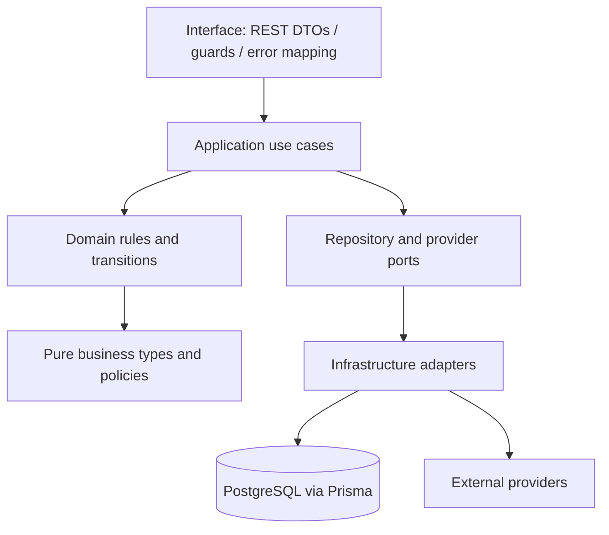

# LumiCal — Architecture

Status: **Approved/frozen R04 technical baseline**. Governing authorities: [Product Scope](PRODUCT_SCOPE.md), [Business Rules](BUSINESS_RULES.md), [Design System](DESIGN_SYSTEM.md). This defines LumiCal's implementation architecture.

## 1. Architecture goals

Deliver the private twelve-month calendar → immutable Order → verified sandbox payment → explicit recipient share → genuine AR/fallback journey. Keep a university team able to reason about permissions, transactions and provider failures with one backend deployment.

## 2. Quality attributes

Correct ownership and historical content outrank convenience. Payment outcomes must be provable and repeatable requests safe. Revocation must block subsequent recipient reads. All flows support VI/EN, light/dark and the Design System accessibility baseline. Small modules, typed HTTP contracts and disposable PostgreSQL tests provide maintainability; no enterprise uptime claim is made.

## 3. System context

Guests browse active Templates; active owners create/edit private Projects and place Orders; anonymous recipients use an explicit Order share; Admin operates Templates and simulated Fulfillment. External systems are PostgreSQL, media storage, PayPal Sandbox, the eventual AR recognition adapter, and P1 email delivery. No real carrier, real-money payment, newsletter or public social subsystem exists.

## 4. Container architecture

Two separately buildable applications: **Next.js/React/TypeScript App Router frontend** and **NestJS/TypeScript modular-monolith backend**. PostgreSQL persists backend data through Prisma. A same-origin reverse proxy routes `/api/*` directly to NestJS, all other web paths to Next.js. An optional second process from the same backend build polls durable database jobs; it is not a microservice. No broker, Redis or Kubernetes is required.



## 5. Frontend/backend boundary

Next.js owns rendering, interaction, UI state and API consumption. Browser API requests use `/api/v1`; SSR uses a trusted internal backend origin and the **same contract**. SSR selectively forwards the requesting session to the trusted backend and never caches private responses across users. No frontend Prisma/database client, business-rule service, payment secret or provider capture integration exists. Route handlers/Server Actions must not become a second business backend; the reverse proxy owns ordinary API routing.

## 6. Backend internal architecture



Domain code has no NestJS/Prisma/provider dependency. Application code orchestrates permissions, transactions and ports. Infrastructure implements ports; interface code maps transport. Use plain policies/functions for rules where sufficient; avoid aggregates or repositories that add no useful boundary.

## 7. Module boundaries

| Module | Owns | Allowed application collaboration |
| --- | --- | --- |
| Identity | Accounts, passwords, sessions, disable/re-enable | Exposes active-principal checks; P1 recovery uses Email port. |
| Templates | Catalog, immutable published revisions, approved presets/prices | Projects consumes published revision; Admin invokes Template use cases. |
| CalendarProjects | Owner, Working/Archived, revision, twelve Months, dates and preview/readiness | Consumes Templates baseline, Media ownership/readiness and AR preparation state. |
| Media | Upload intent, immutable Ready asset, private delivery/retention | Supplies typed asset facts to Projects/Orders; checks authorized access context. |
| AR | Target preparation and readiness, owner preview, recipient target resolution | Consumes version-bound configuration; never bypasses Sharing. |
| Orders | Checkout intent, authoritative USD calculation, relational snapshot, order cancellation/closure | Consumes consistent Project version; exposes fixed payable request to Payments. |
| Payments | Attempts, provider evidence, unique settlement, verification jobs/inbox | Uses Orders eligibility and fixed amount; exposes verified settlement. |
| Fulfillment | Waiting/Preparing/Demo complete/Stopped and history | Requires Payments settlement; completes Order through shared application transaction. |
| Sharing | Current share generation and recipient access sessions | Requires paid Order snapshot and active owner; authorizes AR/media recipient scope. |
| Admin | Operator permission and audit orchestration | Calls module-owned commands; never directly edits another owner's Project. |
| Notifications (P1) | Meaningful in-product notices | Consumes committed payment/fulfillment facts through durable jobs. |
| Contributions (P2) | Invited wishes and moderation if approved | Dormant; cannot mutate existing snapshots. |

## 8. Dependency rules

Module interfaces expose typed queries/commands, not ORM models. Composition wires adapters. Shared code contains identifiers, clock, transaction context and error vocabulary only. Cross-module transactional workflows belong to application orchestration and pass one transaction context; do not recursively import module internals. Domain policies never query another module directly. Backend Standards specifies permitted collaboration in detail.

## 9. Authentication architecture

Backend-owned opaque sessions, not JWT bearer storage. Use random session identifiers with only a keyed digest stored durably. Production cookie `__Host-lumical_session`: Secure, HttpOnly, SameSite=Lax, Path=/, no Domain. Rotate at login; logout revokes the current session; password reset/account disable revoke all sessions. Technical defaults: 24-hour idle and 7-day absolute expiry, checked by backend clock on every authenticated call. Local loopback development may use a differently named non-Secure cookie; no such setting in a deployed environment.

Cookie-authenticated mutations require a synchronizer CSRF token returned on session bootstrap, sent in `X-CSRF-Token`, and an exact allowed Origin. Token remains in memory. Login/registration also enforce Origin and abuse limits. SameSite alone is insufficient. Local separate ports use an explicit credentialed CORS allowlist, never `*`. Admin assignment is an authorized operator process; no OAuth, email change/verification or self-delete flow is introduced.

## 10. Authorization architecture

Authentication supplies an active principal, not permission to any identifier. Use cases check ownership and Working state; Admin checks purpose/allowed operation; recipient checks valid share generation and active owner. Cross-user identifiers return the safe not-found shape. A user may act as an owner only on their own objects even if also Admin. Account disable atomically invalidates sessions and suspends share access; restore is audited and does not resurrect revoked credentials.

## 11. Media architecture

Define **MediaStorage** port: authorize private upload, inspect uploaded facts, fetch immutable content/derivatives, and delete unreferenced assets. Choose **Cloudinary as the initial storage adapter**, justified by image/video/audio intake and preview support. Uploads use authenticated delivery assets, unique non-overwriting keys and backend-authorized short-lived signed upload intents. Finalization verifies provider-owned size/type/duration and ownership binding; client claims are not evidence of Ready state.

All private owner, support and recipient delivery goes through a backend stream/range proxy with access check on **each new request**, `Cache-Control: private, no-store`, no public CDN/image-optimizer cache and no public provider URL in DTOs. Storage signatures remain backend-side. This is deliberate: a signed provider URL alone cannot enforce immediate revocation on later requests. Original/transformed assets must both be inaccessible anonymously. Public Template illustrations may use explicitly public assets separately. No storage provider can revoke pixels already downloaded; this limit does not permit new unauthorized delivery.

Cloudinary defaults and private/authenticated distinctions require care; verify configured protection using its [access-control documentation](https://cloudinary.com/documentation/control_access_to_media) during I06. If the selected account cannot satisfy these checks, change the infrastructure adapter before uploading participant media, preserving the port and access contract.

## 12. AR architecture boundary

**R1 technology/timing proposal — ready for coordinated review:** [boundary revision](../spikes/ar/I03-acceptance-boundary-revision.md)
and [P05](../spikes/ar/I03-P05-ar-technology-recommendation.md) record LEAD's MindAR image-tracking direction as
SELECT WITH CONDITIONS, with repository/independent approval still pending. This does not change provider neutrality,
authorization or historical-data rules. I03 supplies feasibility/risk/handoff; production preparation is verified in I08,
and actual device/HTTPS/privacy/accessibility/recipient acceptance in I12. Required independent execution is retained at
I08-P06/I12-P05. Other implementation dependencies and I00 acceptance are not waived.

**Original accepted boundary and R04 timing (preserved history; new technology detail remains subject to review):**

No SDK is selected. **ARPreparation** port prepares a target artifact and reports version-bound readiness; **ARRecognition** integration supplies recognition evidence within an authorized owner/recipient experience. A client recognizer may run on-device if the spike proves it; recognition is not authorization. The backend resolves only a target belonging to the authorized version and returns scoped reveal content/media paths. Never expose a public global target→private-media lookup. Captured target artifacts and their provider metadata stay immutable for an Order.

Early I03 spike proves HTTPS/camera behavior, supported mobile browsers, recognition reliability, licensing, privacy, artifact preparation, version binding and fallback. It must test an image+message reveal; video/audio are permitted alternatives, not required invariants. Technology-specific metadata may be opaque inside the adapter, but IDs/readiness/API remain provider-neutral. A missing target or wrong-version match fails closed. Same authorized text/media is available without camera.

## 13. Payment architecture

**PaymentGateway** port implements PayPal Sandbox create/approval-status/capture-status evidence. Backend persists attempt and deterministic provider request IDs before provider work. Browser receives only safe approval navigation and attempt IDs; it may signal return/approval but cannot declare success. Backend validates provider account/environment, bound provider order, exact USD amount and correct capture/settlement evidence before committing Completed.

Use authenticated provider reads after return plus verified webhook intake for late completion, both through one idempotent completion use case. Webhook verification uses trusted provider mechanism/configured webhook identity; do not trust a body event type. Persist verified minimal inbox event and deduplicate provider event IDs. Acknowledge after durable intake; jobs process/retry status checks. Provider calls occur outside database transactions. PayPal operation request IDs supplement, not replace, database settlement uniqueness; verify behavior against [PayPal idempotency](https://developer.paypal.com/api/rest/reference/idempotency/) and [webhooks](https://developer.paypal.com/api/rest/webhooks/). No refund or production payment readiness is implied.

## 14. Sharing/recipient-access architecture

One RecipientShare row per Order holds current generation, credential digest and state. Create/rotate returns the new raw credential only to the owner, over HTTPS; metadata reads return no credential. Share URL places it in a frontend fragment (`/recipient#access=…`), excluded from normal HTTP URLs. The recipient exchanges it in a redacted POST body for a separate opaque HttpOnly recipient cookie; no account login or localStorage secret. The frontend removes the fragment after exchange.

RecipientAccessSession binds that share generation and ordered version, with an initial technical absolute lifetime of 24 hours. Lease expiry does not expire the underlying share: the bearer may exchange the still-valid original link again. Every recipient content/target/media request rechecks current generation, share state and active owner. Rotation/revocation invalidates old leases; account disable suspends them. SameSite=Lax, Secure, HttpOnly, Path=/ cookie `__Host-lumical_recipient` is separate from account session; it grants no owner/Admin operations. Recipient metadata/content excludes Order identity/price/payment/contact/account and provider keys. Disable private caching and analytics/referrer leakage; use `Referrer-Policy: no-referrer` for recipient pages.

## 15. Order snapshot/version architecture

Project revision is a monotonically increasing concurrency number, not a Project lifecycle state. All content/media/AR changes advance it. Order placement checks the current reviewed revision and copies a **relational immutable** calendar version with twelve Month snapshots, date/media associations, target/reveal configuration, captured baseline and price/contact. Media references pin immutable assets and target artifacts. A snapshot is ready atomically with its Order; no mutable Project relation supplies historical display content. Multiple intentional orders may capture the same revision.

## 16. Transaction boundaries

| Operation | Atomic backend database unit | Provider work |
| --- | --- | --- |
| Create Project | Active Template revision read, baseline copy, owner, twelve Months, revision | None. |
| Edit Project/month/date/AR reference | Owner/state/version check, mutation and Project revision increment | Target preparation queued only after commit. |
| Place Order | Owner/readiness/review check, consistent content read, price, Order/snapshot children, media pins, Fulfillment Waiting, idempotency result | None inside transaction. |
| Start Payment | Lock payable Order; no settlement or unresolved attempt; attempt and operation/job intent | Create gateway request after commit. |
| Complete Payment | Lock Order/attempt; match verified evidence, unique settlement, attempt terminal state, release open-checkout slot, job/notification intent | Evidence fetched/verified before short transaction. |
| Cancel unpaid Order | Recheck no settlement/in-flight unknown outcome, Cancelled and Fulfillment Stopped, release open-checkout slot | Uncertain attempts require prior provider-status check. |
| Create/rotate/revoke share | Owner/order/paid state, generation/credential replacement, idempotency result, invalidated access | None. |
| Fulfillment transition | Admin/payment/current version gate, state+history+audit; Demo complete closes Order | None. |
| Template publish/deactivate | Complete revision/presets/price, current publication status, audit/version | None. |
| Disable/re-enable account | Account status, session invalidation, access suspension/explicit restoration audit | None. |

Use PostgreSQL row locks or serializable transactions for snapshot capture/settlement/share races, optimistic expected versions for interactive edits. Project-root locking is shared by every child mutation to prevent mixed snapshots. Verify the supported transaction mechanism for the pinned Prisma version; the [transaction documentation](https://www.prisma.io/docs/orm/prisma-client/queries/transactions) is implementation guidance, not a replacement for these boundaries.

## 17. Concurrency/idempotency strategy

Mutation intents have owner/operation-scoped `Idempotency-Key`, canonical request digest (including original expected/reviewed version) and durable outcome. Same key+same request returns same result; changed request conflicts. An authenticated authorized replay is resolved before checking whether that original successful mutation advanced the version; a new intent must satisfy current version/state. Keep protected financial/share intent records through semester retention; do not assume a short provider replay window permits a second capture. Raw share response is encrypted for replay during a 24-hour delivery window, then unrecoverable; replay afterward returns metadata without regenerating a secret. Missing response requires explicit rotation. Durable payment operation IDs remain stable across network retries. Bounded retry of database serialization/deadlock failure uses the same intent; retry never re-executes a non-idempotent external effect blindly.

## 18. Admin/audit architecture

Audit operator, time, action, target, outcome, concrete purpose and correlation ID. Template edits, account suspension, fulfillment transition and ordered-content inspection are auditable. Ordered media/target inspection starts an AdminContentAccess grant with a 15-minute absolute lifetime bound to actor/Order/purpose; no private draft browsing endpoint exists. Logs omit raw secrets/contact/content. Admin cannot trigger payment settlement or impersonate an owner.

## 19. External provider boundaries

PaymentGateway, MediaStorage, ARPreparation/Recognition and EmailSender ports own integration translation. Infrastructure returns typed domain-neutral outcomes, including unavailable/uncertain cases. P1 email is only needed for recovery; notification delivery is in-product. No provider IDs are business entity IDs. Gateway/webhook keys, storage keys and P1 email credentials stay backend-only.

## 20. Error propagation

Domain/application errors map to the stable envelope in [API Contract](API_CONTRACT.md). Transport failures and provider unavailability remain distinct from business rejection. Frontend displays approved VI/EN explanations, preserves input, and never hides a failed request behind apparent success. Unknown payment result remains pending until evidence resolves it.

## 21. Logging/observability

Structured logs: request/correlation ID, operation, safe object IDs, duration, actor category and error code. Track repeated provider verification failures, pending attempts, failed media jobs and rejected transitions. Never log passwords, cookies, CSRF/share credentials, provider secrets, raw private messages or media. Application logs and durable Admin audit have separate purposes. Basic health/liveness/readiness endpoints reveal no secrets; no enterprise monitoring dependency.

## 22. Configuration/secrets

Validate backend configuration at startup: database, session/hash/encryption keys, allowed origins, fixed provider sandbox mode, webhook identity, storage account and trusted frontend return origin. P1 email is optional until recovery is enabled. Public frontend config contains API path and nonsecret flags only. Use separate dev/test/demo accounts and databases; no existing production DB/dump is an implementation baseline.

## 23. Deployment topology

HTTPS reverse proxy exposes the frontend and approved backend HTTP routes; PostgreSQL remains on the private network and is accessible only through backend persistence infrastructure. The backend alone holds provider account credentials/secrets and performs authoritative provider verification and business operations. Browser communication with an external provider is permitted only through an explicitly authorized bounded flow: a backend-authorized short-lived MediaStorage upload intent, PayPal Sandbox approval navigation, or a selected AR client runtime if mandatory I03 chooses a client-side recognizer. Browser/provider interaction alone is never business evidence or payment proof; provider SDKs and client behavior must not bypass backend authority or the approved API/port boundaries.

Only the HTTPS proxy and approved webhook intake are externally reachable. Same-origin behavior is preferred; explicit separate-port CORS is development-only. Private SSR calls use a trusted internal backend base URL, with no frontend database access. Migration runner uses separate deployment authority; app DB principal cannot alter schema or rewrite immutable history.

## 24. Security architecture

Password hashing with a supported adaptive password hash; session/token digests, TLS, Origin+CSRF, request limits, provider signature verification, parameterized persistence and exact owner/share checks. Validate files by actual metadata; prevent arbitrary URL fetch/SSRF and untrusted active content. AR/media views enforce CSP/provider allowlists, permission policy and no-store. Rate-limit login, recipient exchange and upload intents; no new social authentication capability.

## 25. Architecture constraints

P0 preserves Working/Archived projects, exactly twelve Months, optional per-Order Special Dates, mandatory AR-ready reveal, paid immutable recipient version, USD quantity 1–10 and simulated fulfillment. P1 recovery/notifications and P2 optional modules remain isolated. Never claim a camera scan, payment or shipment occurred from UI state alone.

## 26. Forbidden dependencies

Frontend→database/Prisma; domain→NestJS/Prisma/Cloudinary/PayPal; controller→pricing/state machine; Admin→private draft mutation; recipient→owner identity/Order DTO; payment completion→browser boolean; provider callback→unverified settlement; P0→P2 infrastructure. No microservices, event sourcing, CQRS platform or unnecessary cache/broker.

## 27. Failure scenarios

| Failure | Required response |
| --- | --- |
| Provider succeeded, local response lost | Same operation ID/status check; one settlement committed, no fresh blind capture. |
| Two edits/order clicks race | Expected-version conflict or one idempotent Order; no mixed snapshot. |
| Share rotates during media use | Next request fails old lease; stop new reveal/fetch, retain no-store behavior. |
| Target/media unavailable | Authorized fallback where available; missing media error, no substitute from other user. |
| Owner edits/removes ordered asset | Historical pin retains that Order's content. |
| Worker crashes after intake | Durable job/inbox resumes using stored intent and provider evidence. |
| Account disabled while logged in | Subsequent owner/recipient access rejected; history retained. |

## 28. Payment sequence

```mermaid
sequenceDiagram
  participant UI as Frontend
  participant BE as Backend
  participant DB as PostgreSQL
  participant PP as PayPal Sandbox
  UI->>BE: Start attempt with idempotency key
  BE->>DB: Persist bound attempt and operation intent
  BE->>PP: Create provider flow with stable request identity
  PP-->>BE: Approval navigation
  BE-->>UI: Attempt and safe navigation
  UI->>BE: Approval/return signal
  BE->>PP: Verify binding and provider outcome; idempotent capture if approved
  PP-->>BE: Verified evidence
  BE->>DB: Atomic one settlement and Completed outcome
  BE-->>UI: Verified status
```

## 29. Decision summary

Separate Next.js frontend/NestJS REST modular monolith; PostgreSQL/Prisma with reviewed migrations; durable opaque cookies; relational immutable Order snapshots; Cloudinary behind private media port/proxy; PayPal Sandbox backend adapter; AR provider boundary pending early spike; durable jobs/inbox and explicit idempotency. ADR-001..005 record the major choices.

## 30. Handoff

[Database](DATABASE.md) defines durable models/constraints; [API Contract](API_CONTRACT.md) defines wire behavior; frontend/backend standards define code ownership; [Testing Strategy](TESTING_STRATEGY.md) proves invariants. Version pinning and adapter SDK selection happen at I00/I03/I06, without redefining business authorities. This phase authorizes documentation only.
