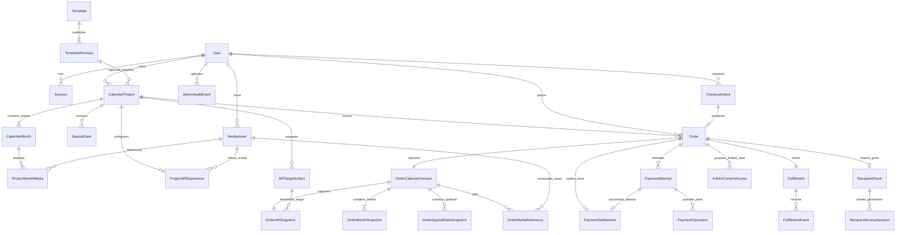

# LumiCal — Database Authority

Status: **Approved/frozen R04 model specification**, governed by [Business Rules](BUSINESS_RULES.md) and [Architecture](ARCHITECTURE.md). Target: **PostgreSQL + Prisma with migration history from day one**. This is a model/constraint specification, not SQL, a Prisma schema or an existing-database conversion plan.

## 1. Modeling principles

Model current Project work separately from immutable ordered versions. Order, PaymentAttempt, PaymentSettlement and Fulfillment have different identities and lifecycles. Persist ownership, version binding, evidence and idempotency; never derive historical content from mutable catalog/project rows. Relational data carries business meaning; opaque provider metadata alone may use structured JSON.

## 2. Naming conventions

Conceptual entity names below use singular PascalCase; future physical tables/columns use consistent snake_case mappings. Foreign relationships end in `Id`; instants end in `At`; amounts end in `Minor`; concurrency counters use `version`. Never reuse `status` across unrelated object meanings without its entity context. API names follow [API Contract](API_CONTRACT.md).

## 3. Identifiers

Backend-generated opaque UUIDs for business entities, never provider IDs or sequential public order numbers as authority. Provider IDs are separately bound to attempts/assets. Credentials/session IDs are cryptographically random bearer secrets, stored only as keyed digests; entity UUIDs are not access credentials.

## 4. Timestamps

UTC instants for creation/update, expiry, transition and evidence receipt; API emits RFC 3339 UTC. Special Dates are Gregorian civil dates tied to the calendar year, independent of UTC timestamp conversion. A backend Clock makes creation-year validation and expiry tests deterministic. Project creation-year range is not rechecked as years pass.

## 5. Archive/delete semantics

User disable/re-enable is separate from deletion. Templates deactivate/archive. Projects Working/Archived; never-ordered Project may be owner-deleted, any ordered Project archive-only. Removing Month media/events changes current work but not snapshot children. Orders/payment evidence/media pins remain through semester retention; cleanup is a privileged documented process, not app cascade behavior.

## 6. ERD

`contains_twelve` is a required business count; ERD cardinality notation alone does not enforce twelve. Technical IdempotencyRecord, ProviderEventInbox and JobRecord support reliable execution and are described below, not public product objects.

## 7. Entity catalog

| Entity / priority | Required concepts | Mutable boundary |
| --- | --- | --- |
| User / P0 | normalized email, password hash, account role, active/disabled condition, audit timestamps | Identity/security only; no transfer of Project ownership. |
| Session / P0 | user, session digest, CSRF binding, created/last activity/idle and absolute expiry, revokedAt | Revocable durable account session. |
| Template / P0 | stable identity, publication condition, current published revision | Availability pointer; no hard delete. |
| TemplateRevision / P0 | revision number, name/VI-EN managed copy, layout/preset definitions, positive USD unit price | Published revisions immutable; new edits create new revision. |
| CalendarProject / P0 | owner, Working/Archived, title/year/recipient context, baseline revision/name/style/unitPriceMinor, current version | Owner edits current work; baseline/owner stable. |
| CalendarMonth / P0 | project, monthNumber 1–12, optional message | One per Month, no arbitrary missing months. |
| ProjectMonthMedia / P0 | project/month, asset, display order/crop choice, accessible text | At most four image associations per Month; shared owner checked. |
| SpecialDate / P0 | project, valid eventDate, title, optional note | Optional zero or more personal events; same-day distinct events allowed. |
| MediaAsset / P0 | owner, category, Pending/Ready/Unavailable, upload-intent binding, verified size/duration/type, opaque storage reference, immutable content version | Pending→Ready finalization; Ready object bytes never overwritten. |
| ProjectARExperience / P0 | project, designated Month/target concept, reveal MediaAsset, readable message/transcript, preparation state/source revision | Current owner config; image/video/audio alternative. |
| ARTargetArtifact / P0 | Project, prepared source revision, provider-neutral target ID, preparation status, artifact storage reference, adapter metadata | Ready artifact immutable and independent of mutable AR config; replacements make new artifact. |
| CheckoutIntent / P0 | owner/project/revision, canonical accepted checkout request, created Order, releasedAt | Serializes normal retries of an open unpaid version; settlement or final unpaid cancellation releases slot atomically for intentional later order. |
| Order / P0 | owner/project, checkout intent, Placed/Cancelled/Closed, quantity, USD unit/total minor, contact, version | Header content/price fixed; lifecycle alone changes. |
| OrderCalendarVersion / P0 | one Order, source Project revision, year/title/dedication, captured Template identity/name/style | Immutable historical root. |
| OrderMonthSnapshot / P0 | version, month 1–12, message/layout | Immutable twelve children. |
| OrderSpecialDateSnapshot / P0 | version, date/title/note | Immutable **optional** event children. |
| OrderMediaReference / P0 | version, Month or reveal purpose, pinned asset, position/crop/accessibility text | Immutable association and retention pin; no provider delivery URL. |
| OrderARSnapshot / P0 | version, target artifact identity, intended media reference, readable text/fallback representation | Immutable correct target/content binding. |
| PaymentAttempt / P0 | Order, lifecycle, environment/provider name, provider order/capture refs, evidence summary, version | Only gated attempt transitions. |
| PaymentOperation / P0 | attempt, operation kind, stable provider request ID, request digest, uncertain/known result | Durable create/capture/status-check execution identity. |
| PaymentSettlement / P0 | unique Order, unique successful attempt/capture ref, verified amountMinor/currency, evidence and completion time | Append-only payment truth. |
| Fulfillment / P0 | one Order, Waiting for payment/Preparing/Demo complete/Stopped, version | Admin transitions after settlement gate. |
| FulfillmentEvent / P0 | fulfillment, previous/next state, actor/reason/time/correlation | Append-only history. |
| RecipientShare / P0 | unique Order, generation, current credential digest or revoked state, suspension/restoration metadata | Owner grant/revoke/rotate only; no raw credential. |
| RecipientAccessSession / P0 | share generation, lease digest, expiry/revocation, recipient CSRF binding | Anonymous revocable lease; no owner identity claim. |
| AdminContentAccess / P0 | Admin, Order, concrete purpose/reason, expiry, audit association | Short-lived read authorization for immutable ordered content only. |
| AdminAuditEvent / P0 | operator, operation/target/outcome, purpose, safe timestamps/correlation | Append-only, no raw private content/secrets. |
| IdempotencyRecord / P0 | actor/operation/key uniqueness, request digest, pending/result, safe resource reference, encrypted secret-bearing replay envelope with expiry if needed | Atomic outcome binding; no unaudited replay mutation. |
| ProviderEventInbox / P0 | provider/environment/event ID, verified evidence summary, processing condition | Deduplicated durable verified intake. |
| JobRecord / P0 | job kind/object/operation identity, attempts, due time, claimed lease, safe error | Pollable bounded provider verification/preparation/cleanup work. |

## 8. Relationship catalog

Orders reference an owner's Project and independently own an immutable snapshot. Snapshot displays use snapshot rows, never live Project/Template fields. Media references must point to assets of that same original owner; enforce composite ownership relationships where practical plus transaction checks. AR snapshot media must be among the version's pinned references and target among its captured artifacts. Payment/settlement must bind to the same Order. Recipient access binds to share generation, not a mutable Project. AdminContentAccess never references a draft.

## 9. Constraints

Non-null owner/reference and restricted-delete foreign keys protect historical roots. Owner is never updated through normal persistence interface. Validate lifecycle membership, media category/readiness, active grant state and provider environment. Composite references prevent same-ID relationships with mismatched Order/owner where feasible. Backend still checks permissions; database identifiers do not authorize reads.

## 10. Unique constraints

| Constraint | Purpose |
| --- | --- |
| User normalized email | One account per normalized address. |
| Template + revision number | Stable published baseline identity. |
| Project + monthNumber; snapshot + monthNumber | No duplicated Month. |
| Order + calendar version; Order + Fulfillment | One fixed snapshot and operational record. |
| Order + RecipientShare; share credential digest | One current share row/digest. |
| PaymentSettlement Order; attempt; provider/environment capture reference | No second paid outcome for Order or repeated provider capture claim. |
| One active attempt per Order (conditional uniqueness or explicit coordination row) | Prevent concurrent unresolved payment starts. |
| CheckoutIntent owner/project/revision while unreleased | Normal retry resumes existing open unpaid Order. |
| actor + operation + idempotency key | One durable request intent. |
| attempt + provider operation kind; provider request ID | Stable gateway action across retries. |
| provider + environment + event ID | Duplicate webhook intake has one effect. |
| Session/recipient lease/reset-token digests | No duplicate bearer identity. |

Conditional unique/index features must be expressed in reviewed migration artifacts supported by the pinned PostgreSQL/Prisma tooling; no assumption that all protections are representable solely through an ORM model.

## 11. Check constraints / protection candidates

Month number within 1–12; quantity integer 1–10; positive unitPriceMinor; USD only; totalMinor equals unitPriceMinor × quantity; adjustment amounts all zero; allowed lifecycle values; nonnegative duration/bytes; snapshot year/date relationships where a row has the required values. Exact twelve-child count, account active, correct media owner, Leap Day validity and paid-before-fulfillment are cross-row/business rules, **not guaranteed by CHECK alone**. Backend transaction validation and appropriate FK/locking protect them; use database trigger only if review proves a real additional protection is needed.

## 12. Index strategy

Index owner+Project state+updatedAt+ID; owner+Order createdAt+ID; Template publication; Project events/date; media owner/readiness; PaymentAttempt Order/time; settlement provider reference; Fulfillment state; current share digest; session digest/expiry; job due/condition; inbox process condition; audit actor/target/time. FK lookup indexes support retention joins. Prefer measured query plans over adding indexes to every column. Stable cursor paging uses timestamp+ID tie-break.

## 13. Transaction-sensitive data

Follow Architecture §16. Project-root locks and revision comparisons coordinate all child edits/snapshot reads. Order lock serializes start/completion/cancellation/fulfillment gates. Atomic share generation change invalidates leases at subsequent access. Template publication and Project baseline read cannot race into a half-published revision. Serialization retry reuses idempotency intent; external calls remain outside locks.

## 14. Immutable snapshot strategy

Choose relational version root + Month/date/media/AR children over one opaque JSON document. This allows twelve-Month checks, media retention, readable support queries and version-bound recipient projections. Bounded style/layout definitions and AR provider artifact metadata may be structured JSON with schema version; core ownership, price, content, associations and payment facts stay relational. Tradeoff: more rows/copy logic, justified by historical correctness and traceability.

Backend persistence permits snapshot inserts at Order placement but no ordinary update/delete afterward. Database app grants/guarded immutable-table permissions prevent historical rewriting where feasible; a separately authorized retention-cleanup principal is the only eventual purge path. Corrections mean a future Project version/new Order, not an edit to an old snapshot.

## 15. Media persistence

Persist verified metadata and private provider reference, not a permanent delivery URL. Ready bytes and required prepared derivatives are immutable/non-overwriting. Snapshot media reference pins content through assessment despite current replacement. Garbage collection checks *all* current Project and Order references plus in-flight jobs under coordinated locks before deleting provider asset; failure retries and access is already removed. No automatic deletion of shared assets on Project edits.

## 16. Sharing/access persistence

RecipientShare unique Order row represents current grant; rotation increments generation and replaces digest, revocation clears usable credential while retaining audit/state. RecipientAccessSession records generation and 24-hour technical expiry, becoming unusable on mismatch, revocation, owner disable or expiry; the underlying share has no automatic expiry. Hash lookup does not reveal raw link. Only create/rotate response returns secret; encrypted IdempotencyRecord replay envelope is limited to 24 hours. Metadata read/ Admin never returns hash, raw credential or that envelope. Project archive leaves existing grants intact; first share requires Working source Project per Business Rules.

## 17. Payment attempt persistence

Initiated/Awaiting approval/Verifying/Completed/Cancelled/Failed match business meanings. Multiple failed/cancelled attempts permitted; Completed only when unique PaymentSettlement atomically inserted with verified exact USD amount/currency and bound provider identifiers. Provider-owned metadata may be bounded JSON; persist normalized reference, amount, currency, environment and evidence timestamp separately. Unknown outcome never becomes failure from a timeout alone. Unique settlement survives duplicate/out-of-order events.

## 18. Fulfillment/history

One Fulfillment per Order, initially Waiting. Admin Preparing transition requires verified settlement; Demo complete atomically closes Order. Cancelled unpaid Order atomically changes Waiting to Stopped. FulfillmentEvent records each legal transition and version; duplicate/stale update cannot advance twice.

## 19. Admin audit

Persist necessary operator/action/target/purpose/outcome/correlation and state changes; record read inspection grants and scoped media access. No secret or copied personal payload in audit. Only necessary ordered content is inspectable; no Admin-to-draft editor relationship/entity. Audit cleanup follows course retention.

## 20. Session model

Opaque keyed digests with user binding, idle/absolute expiry, revokedAt and synchronizer CSRF binding. Password reset/disable revoke all User Sessions transactionally. Authorization always checks active User even if sessions were not yet physically purged. Recipient lease is a separate table/principal; it cannot log into owner routes. Cleanup expired sessions through a bounded job.

## 21. Password reset and notifications — P1

Dormant **PasswordResetToken**: User, keyed token digest, expiresAt, consumedAt; single-use transaction changes password/revokes sessions. Dormant **Notification**: owner, canonical event type/object, safe summary/readAt and event uniqueness; only verified payment/meaningful fulfillment events. EmailSender dependency appears with recovery implementation. No email verification, email-change or marketing schema.

## 22. P2 isolation

Contributions/invitations/moderation and optional editorial/analytics models belong to separate future migrations after approval. P0 contains no wish/like/comment/review/newsletter tables and no required P2 FK. Future approved wishes enter future versions, never modify an existing Order. Dormant definitions are not migration authorization.

## 23. Retention implications

Business Rules BR-PRV-004/005 governs: retain necessary snapshot/payment/media/contact through assessment, documented cleanup within 30 days afterward unless institution explicitly sets another period. Revocation/deletion/suspension blocks access before physical cleanup. Purge ordered references only as one authorized end-of-demo plan; consider provider deletion and backup expiry in that plan. No legal retention claim or production DB operation is made.

## 24. Migration policy

Create an empty PostgreSQL database with a reviewed initial Prisma migration; every subsequent schema/index/constraint change gets versioned migration history. Dev/test/demo all use PostgreSQL. Generate/review migrations in development, run deployment migration workflow once with dedicated authority; no `db push` deploy strategy or SQLite workaround. Review generated DDL/lock/data-loss implications, test blank DB and upgrade fixture, retain applied history unchanged. The exact CLI syntax is verified for the version pinned at I00.

## 25. Seed strategy

Idempotent synthetic Users/Templates with VI/EN catalog copy, USD examples and controlled Admin provisioning. Use only synthetic data; no real photos/contact or committed passwords/secrets. Test fixtures explicitly create Ready media/target evidence through test adapters; presentation recordings are labeled and cannot stand for genuine acceptance. Seeding never marks a real provider attempt paid by a browser flag.

## 26. Data integrity invariants

Exactly one owner and twelve Months; fixed baseline/snapshot; optional event count; same-owner media; one paid settlement; current generation share; Waiting fulfillment until settlement; no actor/context leaks. P0 relational model supports image+message AR as well as short video/audio; no non-null video requirement. No Project status `Ordered`/`Paid` and no combined Order-Payment-Fulfillment enum.

## 27. Anti-patterns

Opaque entire Order JSON, floats for money, public storage URL as authorization, cascade-delete historical media, ORM DTO leakage, enum reuse that collapses lifecycles, provider ID as owner ID, DB CHECK claims for cross-table rules, mutable Template relation for historical Order display, live Project queries for recipient content, plaintext bearer secrets or production/test SQLite.

## 28. Invariant mapping

| Business invariant | Database protection plus application responsibility |
| --- | --- |
| INV-01 | Non-null owner FK; no owner-update command. |
| INV-02 | Unique/range Month checks; atomic twelve creation/snapshot count. |
| INV-03 | Durable owner FK; use-case authorization every read/write. |
| INV-04 | Scoped recipient snapshot relation; explicit safe DTO projection. |
| INV-05 | Immutable relational snapshot + pinned media/artifact. |
| INV-06 | Evidence/settlement transaction only from verified adapter result. |
| INV-07 | Sandbox environment stored; API/UI labels tested. |
| INV-08 | Version/target/media FK binding; access-first resolution. |
| INV-09 | Settlement gate, fulfillment history and Admin audit transaction. |
| INV-10 | Inbox/event/operation uniqueness + settlement uniqueness. |
| INV-11 | Captured published revision; transactional active check for new Project. |
| INV-12 | Unique share per Order, generation and digests; access recheck. |
| INV-13 | Unique settlement Order/attempt/provider capture; serialized completion. |
| INV-14 | Restricted historical references and archive-only ordered Projects. |
