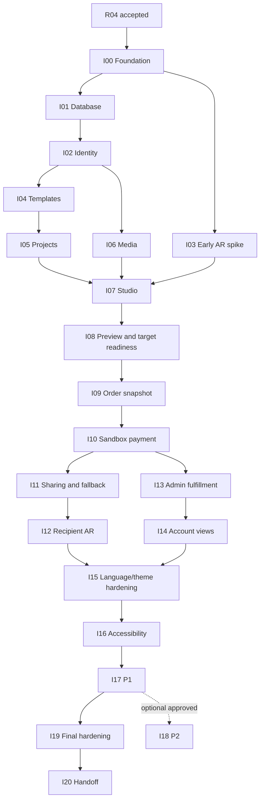

# LumiCal — Execution Roadmap

Status: **Approved/frozen R04 dependency-driven plan for the new repository**. Governed by [Product Scope](PRODUCT_SCOPE.md), [Business Rules](BUSINESS_RULES.md), [Architecture](ARCHITECTURE.md) and [Development Workflow](DEV_WORKFLOW.md). Dates/team capacity are not invented. Milestones record observable acceptance, not permission to implement during this documentation task.

## 1. Completed planning baseline

| Phase | State / evidence |
| --- | --- |
| R00 Discovery | DONE — discovery analysis complete; implementation uses the authority pack. |
| R01 Design System | DONE — frozen v2 decisions packaged in DESIGN_SYSTEM.md. |
| R02 Product Scope | DONE — approved PRODUCT_SCOPE.md. |
| R03 Business Rules | DONE — approved BUSINESS_RULES.md with reviewed optional-events/image-AR correction. |
| R04 Authority technical documentation | **DONE** — coordinated authority baseline reviewed, accepted and frozen after the final consistency patch. No application/repository is initialized. |

## 2. Execution principles

Each milestone requires reviewed ticket/contract/model and test evidence. VI/EN, themes, accessible feedback and private access begin with foundation, then are hardened later; they are not optional late additions. Schema starts as reviewed PostgreSQL migrations. P0 events are a product capability, optional per calendar; demo still shows one. All Order-ready work includes a genuine prepared AR target/reveal. The early spike selects technology, while final recipient integration occurs after paid snapshot/sharing exist. No P2 dependency blocks mandatory milestones.

## 3. Milestones

**R1 I03 acceptance-timing revision, ready for coordinated review:** LEAD requests early feasibility/conditional technology
selection rather than product-device acceptance at I03. [The revision record](../spikes/ar/I03-acceptance-boundary-revision.md)
preserves original requirements, accepted risks, review provenance and V01–V12 owners/gates. I08/I09/I12 inherit the verification,
including independent execution; no product requirement or other dependency is removed. The revised I03 row below is part
of this pending review package, not a claim of I03 Done or downstream admission.

| Milestone | Goal and scope | Dependencies | Deliverables | Acceptance gate | Explicit non-goals |
| --- | --- | --- | --- | --- | --- |
| **I00 Repository / Project Foundation** | Establish new separate Next.js frontend + NestJS backend workspace, typed API/build/config and shared DS foundation | R04 accepted | New repo/app skeletons, pinned supported versions/lockfile, documented env examples, CI, safe same-origin dev setup, VI/EN/theme shells | Both apps build/typecheck/lint; public/form/dialog/Admin DS slice passes common gate; no secrets or frontend DB import | Behavior outside approved authority, feature implementation, production deploy |
| **I01 Database Foundation** | Initialize PostgreSQL/Prisma and reviewed initial P0 model/constraint migrations | I00 | Empty-DB history, disposable test DB, synthetic seeds and transaction abstraction | Blank/upgrade migration tests, exact-money/FK/unique protections and least-privilege roles | SQLite, schema push, production dump/baseline |
| **I02 Identity & Sessions** | Register/login/logout, opaque durable sessions, Origin/CSRF, disable/re-enable audit | I01 | Identity API/UX and ownership principal checks | Session expiry/logout/disable, unique email, cross-actor rejection and cookie tests | Recovery/email verification/OAuth/account self-delete |
| **I03 Early AR Technology Spike** | Establish early recognition/preparation/provider feasibility and a conditional direction before downstream integration | I00; I02 optional for authenticated spike harness | Prepared-target prototype, observed recognition, version-scoped reveal/fallback, evidence/risk inventory, reviewed conditional decision and reproducible handoff | Reviewed feasibility evidence and SELECT WITH CONDITIONS; V01–V12 assigned to I08/I09/I12; independent/LEAD approval and inherited gates. Device/product tests are not falsely marked passed | Production scanner, product-device certification, advanced effects, participant media, global target lookup |
| **I04 Template Catalog + Admin Templates** | Active discovery, complete revisions/presets/USD price and Admin availability | I01, I02 | Public/admin typed API and UI, synthetic catalog | Inactive new Project blocked; published baseline immutable; Admin audit | Discounts, Template hard delete, marketplace |
| **I05 Calendar Project / Twelve Months** | Private Working/Archived ownership and exact year/month foundation | I02, I04 | Project create/read/edit/archive/restore/delete eligibility, twelve-Month persistence and list | Exactly twelve, owner isolation, captured Template survival, expected-version checks | Transfer ownership, freeze-on-order state, free-form editor |
| **I06 Private Media Pipeline** | Backend-authorized Cloudinary adapter intake/finalization, scoped delivery and retention | I02, I01; Project attachment follows I05 | Media port/adapter, Pending/Ready states, private stream proxy, immutable keys/pinning tests | Actual private originals/derivatives denied anonymously; verified limits, duplicate finalize and no public private-media URLs | Public upload library, arbitrary remote fetch, storage-dependent business rules |
| **I07 Studio Personalization** | Edit all Months, image/message, optional personal dates and one owner AR configuration | I05, I06, I03 selected approach | Guided forms/tools, media attachment, leap-date/event editing and AR authoring | All twelve editable; same photo reuse allowed; date optional; image/video/audio alternative and owned media checks | Twelve unique uploads requirement, holidays, event media, multi-target/advanced AR |
| **I08 Preview + Readiness + Target Preparation** | Honest preview and separate readiness, chosen adapter's owner target preparation/preview | I07, I03 | Full/year+month preview/list alternative, immutable Ready target artifact, owner correct-content preview/fallback | Incomplete draft previewable; genuine prepared target ready; image+message accepted; zero-date Project can be Order-ready after review | Recipient publication, fake target-ready flag, print-fidelity claim |
| **I09 Order Snapshot + Checkout** | Authoritative USD quote and immutable relational snapshot with correct media/target pins | I08, I01, I02 | Place Order/idempotency, snapshot/API, quantity/contact summary, unpaid cancellation, Waiting Fulfillment | Concurrent duplicate one Order, consistent reviewed revision/twelve Months, later edits do not alter content/price, no event gate | FX, discounts/tax/shipping fees, real shipment, paid cancellation/refund |
| **I10 PayPal Sandbox Payment** | Durable bound attempts, backend verification, unique settlement and safe retry | I09 | PaymentGateway adapter, approval/return status UX, verified webhook inbox/jobs and status refresh | Genuine sandbox evidence, no browser/Admin mark-paid, repeated completion one settlement, uncertain status and failed/cancelled retry safe | Real money, refund/reconciliation platform |
| **I11 Recipient Sharing + Fallback** | Paid immutable version, one owner grant/current generation and anonymous access | I10, I09, I06 | Create/rotate/revoke, fragment exchange/recipient cookie, safe projection/media/fallback | Unpaid cannot share; revoked/rotated/disabled access fails; archived existing share continuity; no Order/contact/account leak | Mutable draft share, contributor privileges, scan analytics |
| **I12 AR Signature Experience** | Integrate selected recognition approach with genuine authorized ordered target reveal | I03, I08, I11 | Accessible camera/scanner states, ordered target/artifact mapping and same-content fallback | Supported mobile prepared scan correct content; wrong-user target denied; denied/unsupported fallback; prior Order stable after edit | Rich effects, simultaneous/multiple targets, required video-only reveal |
| **I13 Admin Orders / Demo Fulfillment** | Least-privilege operational Order/payment view and audited simulated progression | I10, I09 | Purpose-bound ordered inspection, Waiting→Preparing→Demo complete, history and Order closure | Only Admin after verified payment; stale/skipped transition rejected; no draft editor or paid override | Logistics/carrier/real printing, blanket private media browser |
| **I14 Account Views** | Integrated own Project/Order/payment/fulfillment history and returning workflows | I05, I09, I10, I13 | Owner lists/details, empty/error states, same-intent retry/reorder navigation | Own-only data, immutable snapshot display, logout cache clearing, working/archived continuity | Revenue dashboard/social feeds |
| **I15 VI/EN / Theme Hardening** | Complete vocabulary and visual integration across required flows | I12, I13, I14; foundation from I00 | Full system/admin/payment/AR dictionaries, semantic theme checks | Both languages/themes across core journey, no price/state changes on language switch | UGC auto-translation, redesign of approved tokens |
| **I16 Accessibility / Responsive Hardening** | Complete Design System common gate across real integrated views | I15 | axe results, manual keyboard/screen-reader/zoom/mobile evidence, visual baselines | 320px, 200%, focus/dialog/drawer/reduced motion/media alternative and both themes; exceptions reviewed | Claiming certification from automated test alone |
| **I17 P1 Recovery / Notifications** | Deliver approved supporting work once P0 coherent | I16, I14, I13 | EmailSender recovery proof/reset/session invalidation; in-product consequential notices | Single-use expiry/non-enumeration, successful reset revokes sessions, deduplicated useful notices | Marketing email, email verification/change, every-edit notifications |
| **I18 P2 Stretch (optional)** | Separately approved wishes/editorial/richer AR or insights, capacity permitting | Stable P0; I17 or approved P1 deferral; specific scope approval | Only selected extension docs/contracts/models/tests | Each extension approved and isolated, no historical snapshot mutation; no core regression | Newsletter/reviews/editorial comments/likes or other OUT features |
| **I19 Final E2E / Security / Demo Hardening** | Prove mandatory integrated acceptance and recovery | I12–I17; approved P1 deferral if applicable; **not I18** | Full INV-01..14 evidence, sandbox/device acceptance, secret/authorization/concurrency checks, deterministic synthetic demo | Testing Strategy Definition of Tested; one Special Date in demo, valid zero-date Order test, genuine AR/verified sandbox and honest simulated fulfillment | Treating mock/recording as live proof, optional-feature completion dependency |
| **I20 Final Documentation / Presentation** | Hand off reproducible new project and university explanation | I19 | Setup/operations guide, architecture/ERD/OpenAPI current, safe demo instructions/evidence and presentation | New member reproduces required journey from clean repo; authorities match implementation; reviewer signs demo checklist | Deploying real commerce or rewriting rules to excuse defects |

## 4. Dependency overview



## 5. Parallel work without drift

After I00: DB/identity foundation, DS components and I03 synthetic AR spike can proceed in parallel. After identity/contracts: Template and media work parallel; Studio components can use contract fixtures while backend foundations finish. After fixed Orders: payment, Admin/account presentation can parallel on reviewed DTOs; sharing waits for real settlement gate. Review shared snapshot/target/media and payment/share contracts together. Language/theme/accessibility run alongside each slice, then consolidated hardening validates the integrated whole.

## 6. Current Focus template

```text
Milestone: I00 — next implementation milestone; R04 is approved and DONE
Ticket: not assigned
Owner/reviewer: not assigned
Current implementation branch: none — new repository not created
Goal:
Dependencies/gates:
Authorized scope and exclusions:
Affected authorities / C / BR / INV:
Validation evidence:
Blocker and responsible owner, if any:
Next safe handoff:
```

No implementation milestone is marked implemented by documentation. R04 is approved and DONE; the authority pack is the implementation source of truth for creation of the new repository. This documentation task does not initialize it or begin I00.
