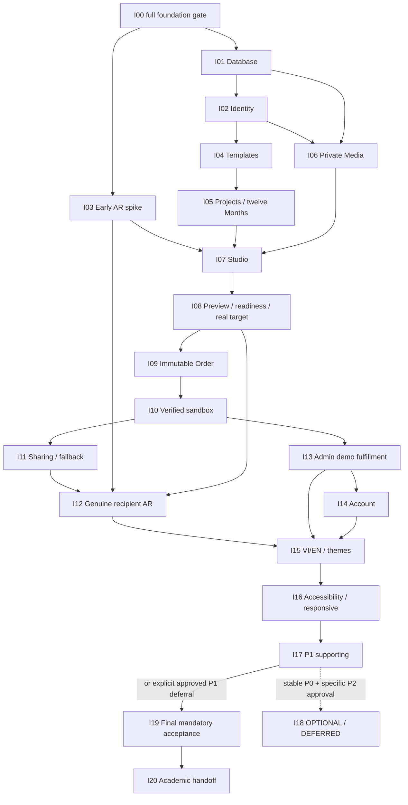

# LumiCal Implementation Plan

## Purpose

[docs/](../docs/README.md) is the frozen authority/source of truth. **planning/** is its execution/task breakdown for four student developers. Planning may evolve as reviewed work progresses; it may **never override authority documents**, expand product scope, promote P1/P2/OUT, select an unproven AR SDK or silently reorder roadmap gates.

Hierarchy: **M0–M5 milestone → canonical Ixx implementation item → Ixx-Pxx implementation task**. Pxx is the normal assignment/MR unit, with exactly one primary owner and LEAD as final reviewer. Milestone groups organize the plan; they are not additional sequential barriers over the ROADMAP dependency graph.

The original pack creation was planning only. Future work described in a Pxx needs its ordinary reviewed implementation ticket; no code is authorized by document generation. The explicitly requested I01 execution and evidence are recorded below. No dates, durations or academic rubric are invented.

## Repository Evidence and Initial Status

Baseline inspected on **2026-10-12**, branch `docs/team-implementation-plan`, clean working tree, HEAD `1e29053`. Commit `f1edca0` completes the narrower team-ready foundation; `1e29053` merges PR #1. Root commands, env examples, technical health/proxy, Vitest/Jest baseline, Docker and CI are tracked. No database, identity or business feature implementation exists.

**I00 technical foundation is merged; full ROADMAP I00 acceptance is not established.** `frontend/src/design-system/` and `i18n/` contain placeholders; the page is temporary and CSS explicitly defers the approved DS. ROADMAP §3 also requires VI/EN/theme shells and a public/form/dialog/Admin DS slice common gate. Therefore I00 is **IN_PROGRESS**, with only I00-P01–P03 **DONE**. Scope clarification blocks new P04/P06 work until explicitly resolved; none of I01–I20 is falsely DONE. I18 is DEFERRED.

Historical DONE entries reflect repository/history and the earlier I00 evidence, not tests rerun during this planning task. Role assignments express accountability for the plan; they do not attribute earlier commits to people whose names are unknown.

**I01 execution update — 2026-10-12:** I01 and P01–P08 are now **IN_REVIEW** on `feature/I01-database-foundation`, following the explicit I01 implementation request. PostgreSQL 17.11/Prisma 7.10.0 persistence, separate migration/runtime roles, 30 P0 models, immutable history, synthetic seeds, transaction contexts and live/ready health are implemented. Frozen install, peers, root `pnpm verify`, real blank/repeat/upgrade PostgreSQL integration and full Docker/database outage smoke passed locally. [I01 evidence](I01-database-foundation.md#execution-evidence--2026-10-12) records the technical checks and remaining human approval. Frozen authority bytes are unchanged; no commit/push was made. I00's outstanding DS/i18n common gate and all other item statuses/dependencies remain unchanged; I01 implementation is not approval for dependent feature expansion.

**I00 completion execution update — 2026-10-17:** LEAD explicitly authorized the full ROADMAP visual/language gate without waiver or deferral. P04–P07 are implemented with shared tokens/controls/Dialog/preferences, neutral public/form/Admin examples and browser/axe/visual evidence. I00 and P04–P07 remain **IN_REVIEW** pending real browser-toolbar zoom, screen-reader and human acceptance; P01–P03 remain historical DONE. The earlier scope blocker is resolved. See [current I00 evidence](I00-repository-project-foundation.md#execution-evidence--2026-10-17). I01/I02 implementation and statuses are preserved.

## Team Ownership

**I03 R1 closeout review — 2026-10-23:** LEAD explicitly requests early-feasibility/conditional-selection scope with product
preparation acceptance in I08 and device/privacy/manual/independent acceptance in I12. [The revision record](../spikes/ar/I03-acceptance-boundary-revision.md)
retains original requirements/provenance and exact owners/gates. I03 is IN_REVIEW, not DONE; coordinated/independent/LEAD
review and unchanged I00 acceptance remain pending. This authorized review package includes technical-authority proposals;
the original planning-pack prohibition on authority edits is not used to claim those proposals already accepted.

| Role | Primary ownership | Architecture authority | Review responsibility |
| --- | --- | --- | --- |
| LEAD | Core model/database, identity/security, Calendar Project invariants, immutable Orders, exact pricing/payment, AR decision/final integration | Owns implementation architecture **within** frozen authorities; coordinates scope/business/visual authority-owner decisions; cannot unilaterally rewrite them | Final review of every implementation MR; sensitive boundary approval; requires independent teammate review for own work |
| MEMBER_2 | Templates backend/public contract, Studio/Project/preview/checkout/account experience, approved DS application | Owns presentation/integration choices within reviewed contracts and approved DS | Product/DS/API consumer review; independent teammate review of LEAD work when relevant |
| MEMBER_3 | Media/backend adapters, early AR prototype, target preparation, Sharing/recipient access, fallback and recognizer integration | Owns adapter implementation within LEAD-approved ports; no independent SDK/privacy-boundary selection | Provider/device, private-media and cross-version review; independent core review when relevant |
| MEMBER_4 | Admin and Fulfillment backend/UI, account suspension/status APIs, notifications, language/theme/accessibility fixes, reproducibility and quality coordination | Owns operational implementation within reviewed domain/security contracts | Operational/audit/common-gate review and final quality evidence; meaningful implementation ownership as well as tests |

Primary Pxx counts: LEAD **25**, MEMBER_2 **29**, MEMBER_3 **31**, MEMBER_4 **41**; **126 tasks** total. Counts are not effort estimates. LEAD's fewer tasks carry transaction/security/commerce risk plus every MR review. MEMBER_4 has more bounded operational and integrated-quality slices, including actual backend/UI work; phase staffing must reserve review and device/evidence time rather than assume equal effort per task.

## Milestone Map

| Milestone | Implementation items | Priority boundary |
| --- | --- | --- |
| M0 — Foundation | I00 | P0 foundation; complete manual/common-gate acceptance |
| M1 — Core Platform | I01–I03 | P0 database/identity and mandatory early AR spike |
| M2 — Calendar Creation | I04–I08 | P0 catalog, Project, private media, Studio, preview/readiness/preparation |
| M3 — Order & Recipient Experience | I09–I12 | P0 snapshots, verified sandbox, sharing/fallback and genuine AR |
| M4 — Product Completion | I13–I18 | I13–I16 P0; **I17 P1 required supporting**; **I18 P2 OPTIONAL/DEFERRED** |
| M5 — Release & Academic Delivery | I19–I20 | Mandatory hardening and handoff; no I18 dependency |

## Full Ixx Ownership Matrix

Names are the exact canonical ROADMAP names. Ixx primary owner coordinates integration; Pxx owners do implementation.

| Ixx | Name | Milestone | Primary owner | Supporting members | Reviewer | Hard dependencies / admission | Priority | Status |
| --- | --- | --- | --- | --- | --- | --- | --- | --- |
| [I00](I00-repository-project-foundation.md) | Repository / Project Foundation | M0 | LEAD | MEMBER_2, MEMBER_4, MEMBER_3 | LEAD | R04 accepted; explicit full-scope LEAD authorization | P0 | IN_REVIEW |
| [I01](I01-database-foundation.md) | Database Foundation | M1 | LEAD | MEMBER_2, MEMBER_3, MEMBER_4 | LEAD | I00 | P0 | IN_REVIEW |
| [I02](I02-identity-and-sessions.md) | Identity & Sessions | M1 | LEAD | MEMBER_2, MEMBER_3, MEMBER_4 | LEAD | I01 | P0 | IN_REVIEW |
| [I03](I03-early-ar-technology-spike.md) | Early AR Technology Spike | M1 | MEMBER_3 | LEAD, MEMBER_4 | LEAD | I00 | P0 | IN_REVIEW |
| [I04](I04-template-catalog-and-admin-templates.md) | Template Catalog + Admin Templates | M2 | MEMBER_2 | MEMBER_4, MEMBER_3, LEAD | LEAD | I01; I02 | P0 | TODO |
| [I05](I05-calendar-project-twelve-months.md) | Calendar Project / Twelve Months | M2 | LEAD | MEMBER_2, MEMBER_4, MEMBER_3 | LEAD | I02; I04 | P0 | TODO |
| [I06](I06-private-media-pipeline.md) | Private Media Pipeline | M2 | MEMBER_3 | LEAD, MEMBER_2, MEMBER_4 | LEAD | I02; I01 | P0 | TODO |
| [I07](I07-studio-personalization.md) | Studio Personalization | M2 | MEMBER_2 | LEAD, MEMBER_3, MEMBER_4 | LEAD | I05; I06; I03 | P0 | TODO |
| [I08](I08-preview-and-readiness-and-target-preparation.md) | Preview + Readiness + Target Preparation | M2 | MEMBER_3 | LEAD, MEMBER_2, MEMBER_4 | LEAD | I07; I03 | P0 | TODO |
| [I09](I09-order-snapshot-and-checkout.md) | Order Snapshot + Checkout | M3 | LEAD | MEMBER_2, MEMBER_3, MEMBER_4 | LEAD | I08; I01; I02 | P0 | TODO |
| [I10](I10-paypal-sandbox-payment.md) | PayPal Sandbox Payment | M3 | LEAD | MEMBER_2, MEMBER_3, MEMBER_4 | LEAD | I09 | P0 | TODO |
| [I11](I11-recipient-sharing-and-fallback.md) | Recipient Sharing + Fallback | M3 | MEMBER_3 | LEAD, MEMBER_2, MEMBER_4 | LEAD | I10; I09; I06 | P0 | TODO |
| [I12](I12-ar-signature-experience.md) | AR Signature Experience | M3 | MEMBER_3 | LEAD, MEMBER_4, MEMBER_2 | LEAD | I03; I08; I11 | P0 | TODO |
| [I13](I13-admin-orders-demo-fulfillment.md) | Admin Orders / Demo Fulfillment | M4 | MEMBER_4 | LEAD, MEMBER_3, MEMBER_2 | LEAD | I10; I09 | P0 | TODO |
| [I14](I14-account-views.md) | Account Views | M4 | MEMBER_2 | MEMBER_4, MEMBER_3, LEAD | LEAD | I05; I09; I10; I13 | P0 | TODO |
| [I15](I15-vi-en-theme-hardening.md) | VI/EN / Theme Hardening | M4 | MEMBER_4 | MEMBER_2, MEMBER_3, LEAD | LEAD | I12; I13; I14 | P0 | TODO |
| [I16](I16-accessibility-responsive-hardening.md) | Accessibility / Responsive Hardening | M4 | MEMBER_4 | MEMBER_2, MEMBER_3, LEAD | LEAD | I15 | P0 | TODO |
| [I17](I17-p1-recovery-notifications.md) | P1 Recovery / Notifications | M4 | MEMBER_4 | LEAD, MEMBER_2, MEMBER_3 | LEAD | I16; I14; I13 | P1 required supporting | TODO |
| [I18](I18-p2-stretch-optional.md) | P2 Stretch (optional) | M4 | LEAD | MEMBER_2, MEMBER_3, MEMBER_4 | LEAD | Stable accepted P0; I17 or explicit approved P1 deferral; Specific scope-owner approval for the selected P2 extension | P2 / OPTIONAL | DEFERRED |
| [I19](I19-final-e2e-security-demo-hardening.md) | Final E2E / Security / Demo Hardening | M5 | MEMBER_4 | LEAD, MEMBER_2, MEMBER_3 | LEAD | I12; I13; I14; I15; I16; I17 or explicit approved P1 deferral | P0 | TODO |
| [I20](I20-final-documentation-presentation.md) | Final Documentation / Presentation | M5 | MEMBER_4 | LEAD, MEMBER_2, MEMBER_3 | LEAD | I19 | Required academic handoff | TODO |

I19's I17 gate can be replaced only by a documented **Product Scope owner-approved P1 deferral**, never by this plan or developer convenience. I18 admission requires stable accepted P0, controlled P1 and specific approval for the selected P2 extension. OUT capabilities remain excluded. I20 is required academic delivery, not a new commercial deployment milestone.

## Dependency Overview

[ROADMAP §3](../docs/ROADMAP.md#3-milestones) supplies the complete dependency rows; the diagram shows major branches and joins.

Every Ixx file separately lists **Blocked by**, **Blocks** and **Can run in parallel with**, as well as hard versus helpful dependencies. I06 can handle independent assets after I01/I02; attachment needs I05. I03 does not need I02 unless the spike uses the optional authenticated harness. I11 requires verified paid snapshot access, not just an approval return. I13 need not wait for I11/I12; I14 requires real I13 outcomes. I18 has no edge to I19/I20.

## Parallel Work Guidance

- After the full I00 gate: I01 and synthetic I03 can proceed alongside permitted DS foundation work. A synthetic AR harness is not production authentication or final recipient security proof.
- After I02 and reviewed contracts: I04 Template and I06 Media tracks run independently; I05 starts after I04. Studio **presentation** may use reviewed contract fixtures while foundations finish, as ROADMAP §5 permits. I07 integration and technology-specific authoring still require I03/I05/I06.
- Within a slice, merge domain/use-case/port/DTO decisions before adapters or large UI integration. Contract fixture preparation is explicitly distinct from implementation merge/acceptance and never fakes Ready media/targets or paid Orders.
- After accepted fixed Orders: payment work and reviewed Admin/account presentation fixtures may overlap. Actual I13 payment-gated transitions and I14 acceptance wait for their hard dependencies. Sharing waits for I10 genuine settlement acceptance.
- I11 and I13 can proceed after I10; I12 and I14 can then proceed at their **independent** gates. One member's simultaneous assignments are a work queue, not a claim that one person can execute two tasks at once.
- VI/EN, theme, responsive and keyboard evidence accompany every approved slice; I15/I16 consolidate complete integrated coverage. Documentation can be drafted for accepted work, but I20 final acceptance waits for I19.
- I17 recovery and notifications are independent P1 tracks after I16/I14/I13. I18 stays optional and consumes no time needed for mandatory gates unless explicitly admitted.

## Recommended Team Execution Sequence

Phases are acceptance windows, **not dates, sprint lengths or new authority ordering**. Open an eligible later track as soon as its own gate passes; do not wait for an unrelated row to finish. Within each role's cell, follow the linked Pxx dependencies and work sequentially where needed. A blocked member may perform a listed predecessor's teammate review; do not start dependent code or invent filler.

| Phase / entry gate | LEAD | MEMBER_2 | MEMBER_3 | MEMBER_4 |
| --- | --- | --- | --- | --- |
| A — I00 completion review | Review common-gate evidence and record final acceptance | Review implemented P04/P05 and manual focus/assistive checks | Independent teammate review of the I00 slice; existing later-item gates remain | Review implemented P06/P07 and complete manual language/theme/zoom evidence |
| B — Full I00 accepted | I01-P01; then P03/P04 after environment/schema gates | Review seed/fixture requirements in P01; I01-P06 after P03–P05 | I03-P01/P02; I01-P05 after P04 as a separate work slot | I01-P02/P08; I03-P03 after prototype; I01-P07 after all required predecessors |
| C — I01 accepted; spike evidence evolving | I02-P01/P02; I03-P05 after device/privacy evidence | Contract review support first; I02-P04 after P02, then P05 | I03-P04/P06 after their gates; I02-P06 after identity/UI tasks | I02-P03 after P02; complete eligible I03 device evidence |
| D — I02 accepted | Review I04/I06 contracts; retain core review capacity | I04-P01/P03 | I06-P01–P04; I04-P05 after catalog/UI prerequisites; finish outstanding I03 proof before I07 | I04-P02/P04 |
| E — I04 accepted; Media track continues | I05-P01/P02 | I05-P04/P05 after P03; I06-P05 after media API/delivery | I06-P06; I05-P06 after Project experience, in separate slots | I05-P03; I06-P07 after intake/UI/cleanup |
| F — I03/I05/I06 accepted | I07-P01 | I07-P02, then P03/P04 | I07-P05 after shell/API | I07-P06 after editors; P07 after integration |
| G — I07 accepted | I08-P01 | I08-P03; P05 after owner target/preview | I08-P02/P04 | I08-P06 after real preparation and review handoff |
| H — I08 accepted | I09-P01/P02/P03 | I09-P05 after Order API | I09-P07 after all integration slices | I09-P04; P06 after API |
| I — I09 accepted | I10-P01/P02; P07 after deterministic proofs | I10-P05 after status API | I10-P03 | I10-P04, then P06 after gateway/jobs/UI |
| J — I10 accepted: Sharing and Admin | I11-P01 plus I13 transition/security reviews | I11-P04; I13-P06 after operational slices | I11-P02/P03/P05; I13-P03 in its own work slot | I13-P01/P02/P04/P05; I11-P06 after grant/recipient slices |
| K — Independent I12/I14 gates | I12-P01; P06 after real-device proof | I14-P01/P02/P04 when I13 is accepted; I12-P04 after recognizer/scanner, in separate slots | I12-P02/P03; I14-P05 after account integration | I14-P03 after account query contract; I12-P05 after reveal/fallback |
| L — I12/I13/I14 accepted | Final review of theme/accessibility corrections and any authority-owner exception decisions | I15-P02; **after I15**, I16-P02 | I15-P03; **after I15**, I16-P03 | I15-P01/P04/P05; **after I15**, I16-P01/P04/P05 |
| M — I16 accepted | I17-P01 | I17-P03 after safe recovery/mail | I17-P02; P06 after recovery and notices | I17-P04/P05 independently of recovery after their contracts |
| N — I17 accepted or explicit approved P1 deferral | I19-P02 | I19-P03 | I19-P04 | I19-P01 first; P05/P06 after agreed scenarios, P07 after all fixes/evidence |
| O — I19 accepted | I20-P01 | I20-P02 | I20-P03 | I20-P04 after technical/product/provider artifacts; P05 independent reproduction |

I18 is deliberately absent from the active sequence. Its three DEFERRED/OPTIONAL tasks cover admission, extension-specific decomposition and regression admission; they authorize neither a particular extension nor an implement-all-stretch MR.

## Review Rules

LEAD reviews **every implementation MR**, including MEMBER_4's operational/quality changes. At least one independent teammate reviews LEAD-owned implementation; LEAD is accountable for the final boundary decision but cannot be the sole approval of their own code. Add the affected module/API/design/database reviewer as appropriate.

The following need **explicit LEAD approval before dependent implementation expands**:

- Authority interpretation and any proposed coordinated authority-owner clarification.
- Database schema/domain invariants, migration protections and shared transactions.
- Auth/session/security, API contract/projection changes and same-origin private transport.
- Order snapshot, pricing, payment evidence, retry/recovery and settlement.
- AR boundary/provider selection and final integration.
- Recipient access, secret/generation/lease behavior and private media delivery.
- Dependency major upgrades.

LEAD approval is not permission to override Product Scope, Business Rules or visual authorities. Follow [DEV_WORKFLOW §§6–13](../docs/DEV_WORKFLOW.md) for the appropriate authority owner's approval and coordinated future change. **No docs/ edit is authorized during this planning task.**

Use short-lived ticket branches and normally one independently reviewable Pxx per MR. Include problem/result, C/BR/INV references, affected interfaces, behavior/negative/race tests and evidence. Tests travel with implementation; cross-slice acceptance does not defer all testing to the end. Domain/ports/DTOs must be reviewed and merged before dependent branches grow; avoid long-lived person/frontend/backend branches.

## Task Status Convention

| Status | Meaning |
| --- | --- |
| TODO | Planned; prerequisites/decisions have not all been accepted; no implementation claimed |
| READY | Ticket scope and contracts settled, required predecessors accepted, evidence/owner known |
| IN_PROGRESS | Authorized work has started or an item is partly implemented with remaining acceptance |
| BLOCKED | A named concrete decision/artifact/external condition prevents the affected work |
| IN_REVIEW | Concrete implementation/evidence submitted for the required review |
| DONE | Acceptance, correct testing layers, quality gates and independent/final review satisfied |
| DEFERRED | Deliberately unscheduled; I18 also explicitly OPTIONAL; P1 deferral needs scope-owner approval |

Move TODO to READY only after actual gate acceptance; a diagram, mock or an assigned owner is not proof. An Ixx remains incomplete while a required Pxx/genuine provider/device/common gate is missing. Record blocker/owner and update planning as evidence changes; preserve authority.

## Definition of Done

Use [DEV_WORKFLOW §22](../docs/DEV_WORKFLOW.md#22-definition-of-done) and [TESTING_STRATEGY §17](../docs/TESTING_STRATEGY.md#17-definition-of-tested-and-final-demonstration):

- Pxx acceptance criteria and the parent Ixx behavior contract are satisfied.
- Meaningful tests are added/updated in the implementation MR; permission, failure and relevant race cases are covered.
- Typecheck, lint, tests and production build pass through the current provider-neutral `pnpm verify` contract.
- Database integrity uses migrated disposable **PostgreSQL**, not SQLite or mocked Prisma evidence; blank/upgrade history and least-privilege checks apply.
- Affected OpenAPI/generated types/serialized responses match the reviewed contract; no frontend database access or duplicate business backend.
- UI uses approved DS and VI/EN/themes, with keyboard/320px/200%/contrast/reduced-motion and manual evidence where relevant.
- Genuine PayPal Sandbox/private-storage/mobile AR acceptance is recorded at its gate; fake CI and labeled outage recordings do not replace it.
- No secrets, personal demo data leak, unapproved scope/priority/architecture expansion or historical snapshot mutation.
- LEAD final review, independent teammate review where required, and the applicable authority-owner approval are recorded.
- Parent integration/demonstration evidence and handoff are complete; optional I18 never blocks a mandatory DONE decision.

## Planning Risks and Authority Clarifications

1. **RESOLVED — I00 acceptance scope.** LEAD explicitly decided: “The full ROADMAP I00 visual/language gate remains part of I00 and is explicitly authorized for implementation; it is not waived or deferred.” P04–P07 are implemented and IN_REVIEW. Required manual evidence and reviewer acceptance remain; no later integrated item becomes READY automatically.
2. **Tooling-pinning timing — execution update.** The original plan flagged I00 pinning references against deferred I01 installation. The explicit I01 implementation request authorized this tooling execution; compatible versions are now pinned and tested. Teammate review of versions/schema/privileges remains pending; authority files and I00 acceptance are unchanged.
3. **Technical alignment at I01:** `/api/v1/health/live` and `/health/ready` now match API_CONTRACT and pass real PostgreSQL/outage checks. The existing `/api/v1/health` compatibility route preserves the I00 frontend proof and is submitted for LEAD review. The Next health-only handler does not establish the business API reverse proxy; I02-P02 explicitly owns that security-sensitive transport setup.
4. **External acceptance gates:** I03 must find viable real mobile recognition/privacy/licensing; I06 must prove actual configured Cloudinary originals/derivatives are private; I10 must prove actual sandbox USD/account binding. Failed evidence blocks the affected item, not a scope rewrite.
5. **Retention policy confirmation:** BR-PRV-004/005 gives the 30-day post-assessment cleanup default; confirm any institution exception before real participant content. Use synthetic data meanwhile; no assessment date or cleanup schedule is invented.
6. **P1/P2 control:** I17 is required supporting work after coherent P0 and may be deferred only by explicit Product Scope approval. No such deferral or P2 admission is present; all I18 tasks stay DEFERRED/OPTIONAL.

## Original Planning Pack Validation

- Exactly 21 canonical I00–I20 files plus this overview; 126 sequential, unique Pxx tasks, each with one owner and LEAD reviewer.
- Task fields, three acceptance checks per task, initial statuses, links/task anchors and stated prerequisite/parallel relationships validated; no task dependency cycle found.
- Only I00-P01–P03 are DONE; I00 acceptance-scope tasks P04/P06 are BLOCKED; all three I18 tasks are DEFERRED/OPTIONAL.
- All 70 pre-existing tracked files remain byte-identical to the initial baseline. Required authority/application/runtime diffs are empty; only planning/ is untracked. No application checks, installations, commits or pushes were performed for this planning task.

